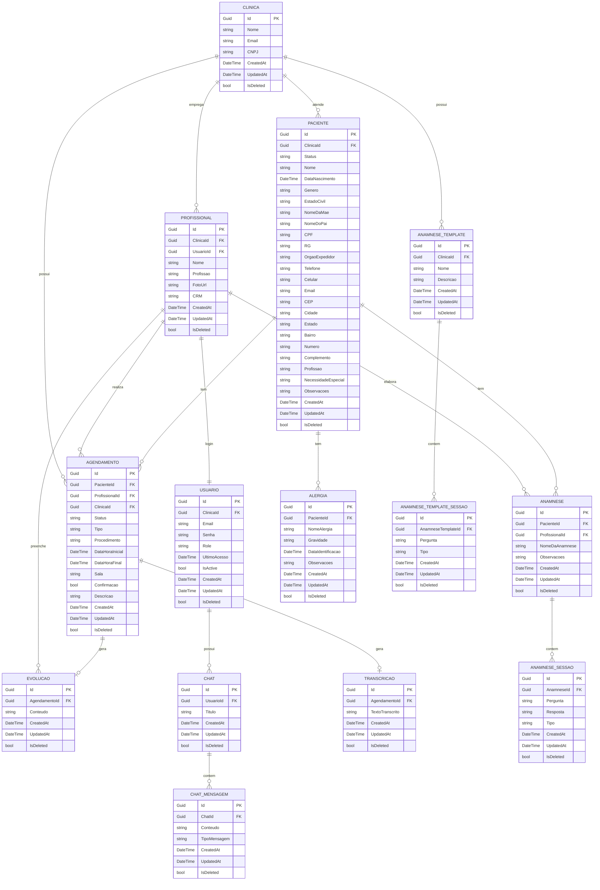

> [!IMPORTANT]
> Este documento descreve a visão funcional e requisitos do projeto.
>
> A seção de modelagem de entidades pode não refletir integralmente a
> implementação atual.
>
> Para decisões técnicas, arquitetura, entidades, relacionamentos e fluxos,
> consulte primeiro o código-fonte e a documentação técnica em `documentos/`.
>
> Em caso de divergência entre este documento e a implementação atual,
> o código-fonte é a fonte de verdade.

# INICIAÇÃO CIENTÍFICA

## Requisitos Funcionais

|ID    | Descrição do Requisito  | Prioridade |
|------|-----------------------------------------|----|
|RF-001| Ativar controle de permissões no sistema baseado no tipo de usuário identificado. | ALTA |
|RF-002| Implementar funcionalidade no sistema de transcrição de áudio por meio de inteligência artificial. | ALTA | 
|RF-003| Implementar um agente de inteligência artificial integrado no sistema que permita ao usuário efetuar prompts e obter respostas. | ALTA |
|RF-004| Permitir cadastro completo de pacientes incluindo dados pessoais e dados clínicos complementares  | ALTA |
|RF-005| Permitir agendamento de consulta/retorno de paciente vinculado à um profissional da clínica  | ALTA |
|RF-006| Permitir visualização de consulta/retorno de paciente vinculado à um profissional da clínica| ALTA |
|RF-007| Permitir o cadastro completo de evolução do paciente com data, tipo profissional e detalhamento  | ALTA |
|RF-008| Permitir a visualização do histórico de evoluções dados do paciente (prescrições, atestados, receitas, dietas, procedimentos etc)  | ALTA |
|RF-009| Permitir a edição e atualização de dados das evoluções e cadastrais dos pacientes   | ALTA |
|RF-010| Permitir que o profissional gerencie o estoque de medicamentos e materiais com alertas de baixo estoque e vencimento de produtos | ALTA |
|RF-011| Permitir gestão de caixa, controle de pagamentos, faturas e relatórios financeiros gerais | ALTA |
|RF-012| Permitir que o usuário com perfil de Administrador da clínica, possua tenha acesso à um relatório financeiro   | ALTA |

## Diagramas de Relacionamento de Entidades

