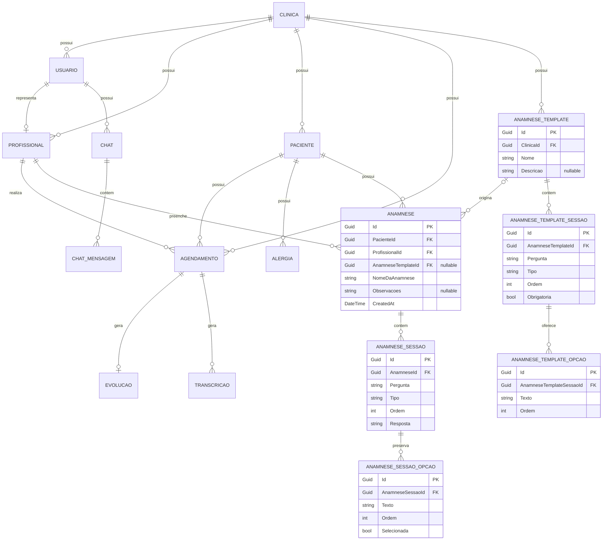

# Persistência e modelo de dados do DoctorPilot

## 1. Escopo e fontes de verdade

Este documento descreve o estado atualmente implementado da persistência do DoctorPilot. Ele é uma documentação viva e deve ser atualizado quando houver mudanças estruturais relevantes no modelo ou no fluxo de persistência.

As fontes de verdade técnicas são, nesta ordem de uso:

1. entidades e abstrações em `DoctorPilot.Core`;
2. implementações de `IEntityTypeConfiguration<T>` e o `DoctorPilotDbContext` em `DoctorPilot.Infrastructure`;
3. migrations do Entity Framework Core;
4. `DoctorPilotDbContextModelSnapshot`.

Quando houver divergência com diagramas ou documentos históricos, o código atual, as configurations, as migrations e o snapshot devem ser investigados em conjunto. Este documento representa o schema e as decisões atuais, não um schema definitivo para todas as versões futuras do DoctorPilot.

## 2. Tecnologias e configuração do banco

A persistência utiliza:

- Entity Framework Core 10.0.9;
- provider `Microsoft.EntityFrameworkCore.SqlServer` 10.0.9;
- SQL Server;
- `DoctorPilotDbContext` como contexto principal.

O contexto é registrado no Dependency Injection por `InfrastructureModule.AddData`:

```csharp
var connectionString = configuration.GetConnectionString("DoctorPilotCs");
services.AddDbContext<DoctorPilotDbContext>(options =>
    options.UseSqlServer(connectionString));
```

A chave de configuração é:

```text
ConnectionStrings:DoctorPilotCs
```

Em Development, a API possui `UserSecretsId` e obtém a connection string local por .NET User Secrets. A connection string real, servidor, usuário, senha e demais credenciais não são versionados nem documentados aqui.

Não há configuração explícita de schema SQL, command timeout, retry de conexão, migrations assembly separado ou comportamento global de tracking.

## 3. DoctorPilotDbContext e DbSets

O `DoctorPilotDbContext` declara 14 `DbSet`s:

| DbSet                     | Entidade                 |
| ------------------------- | ------------------------ |
| `Usuarios`                | `Usuario`                |
| `Agendamentos`            | `Agendamento`            |
| `Alergias`                | `Alergia`                |
| `Anamneses`               | `Anamnese`               |
| `AnamneseSessoes`         | `AnamneseSessao`         |
| `Clinicas`                | `Clinica`                |
| `Evolucoes`               | `Evolucao`               |
| `Pacientes`               | `Paciente`               |
| `Profissionais`           | `Profissional`           |
| `Transcricoes`            | `Transcricao`            |
| `Chats`                   | `Chat`                   |
| `ChatMensagens`           | `ChatMensagem`           |
| `AnamneseTemplates`       | `AnamneseTemplate`       |
| `AnamneseTemplateSessoes` | `AnamneseTemplateSessao` |

As 14 configurations são aplicadas individualmente em `OnModelCreating` por chamadas a `ApplyConfiguration`. Não é utilizada descoberta automática por assembly.

Convenções do EF Core ainda utilizadas:

- nomes das tabelas derivados dos nomes dos `DbSet`s, pois não há `ToTable` nas configurations;
- nomes de PKs, FKs e índices gerados pelo EF Core;
- obrigatoriedade de propriedades escalares não anuláveis quando não há configuração mais específica;
- opcionalidade de propriedades nullable;
- tipos SQL inferidos pelo provider quando não há `HasColumnType`;
- `Id` reconhecido como valor gerado na adição, embora o GUID seja inicializado no CLR e não tenha default SQL na migration.

Depois de aplicar as configurations, o contexto registra centralmente um Global Query Filter para todos os tipos derivados de `BaseEntity`, conforme detalhado na seção de soft delete.

## 4. Entity Configurations

Todas as entidades persistidas possuem uma implementation própria de `IEntityTypeConfiguration<T>`, e todas são aplicadas pelo contexto:

| Configuration                         | Entidade configurada     |
| ------------------------------------- | ------------------------ |
| `UsuariosConfiguration`               | `Usuario`                |
| `AgendamentosConfiguration`           | `Agendamento`            |
| `AlergiasConfiguration`               | `Alergia`                |
| `AnamnesesConfiguration`              | `Anamnese`               |
| `AnamneseSessoesConfiguration`        | `AnamneseSessao`         |
| `ClinicasConfiguration`               | `Clinica`                |
| `EvolucoesConfiguration`              | `Evolucao`               |
| `PacientesConfiguration`              | `Paciente`               |
| `ProfissionaisConfiguration`          | `Profissional`           |
| `TranscricoesConfiguration`           | `Transcricao`            |
| `ChatsConfiguration`                  | `Chat`                   |
| `ChatMensagensConfiguration`          | `ChatMensagem`           |
| `AnamneseTemplateConfiguration`       | `AnamneseTemplate`       |
| `AnamneseTemplateSessaoConfiguration` | `AnamneseTemplateSessao` |

A Fluent API é a fonte principal para configurações explícitas, incluindo PKs, relacionamentos, delete behaviors, índices, unicidade, limites, conversões e defaults. Quando uma característica não aparece na Fluent API, ela pode resultar de convenção do EF Core ou da nulabilidade do tipo C#.

## 5. Entidades e BaseEntity

As 14 entidades persistidas herdam de `BaseEntity`.

`BaseEntity` fornece:

- `Guid Id`: PK de todas as entidades, inicializada no CLR com `Guid.NewGuid()`;
- `DateTime CreatedAt`: inicializada no CLR com `DateTime.UtcNow` e configurada também com default SQL `CURRENT_TIMESTAMP`;
- `DateTime? UpdatedAt`: opcional, sem atualização automática global;
- `bool IsDeleted`: inicializado no CLR e no banco com `false`;
- `MarkAsDeleted()`: define `IsDeleted = true` e atualiza `UpdatedAt` com UTC.

| Entidade                 | Tabela                    | PK   | Clínica direta?                     | Relacionamentos principais                                                |
| ------------------------ | ------------------------- | ---- | ----------------------------------- | ------------------------------------------------------------------------- |
| `Clinica`                | `Clinicas`                | `Id` | É o tenant                          | Principal de usuários, profissionais, pacientes, agendamentos e templates |
| `Usuario`                | `Usuarios`                | `Id` | Sim, `ClinicaId`                    | N:1 clínica; 1:0..1 profissional; 1:N chats                               |
| `Profissional`           | `Profissionais`           | `Id` | Sim, `ClinicaId`                    | N:1 clínica; N:1 usuário com FK única; 1:N agendamentos e anamneses       |
| `Paciente`               | `Pacientes`               | `Id` | Sim, `ClinicaId`                    | N:1 clínica; 1:N alergias, agendamentos e anamneses                       |
| `Agendamento`            | `Agendamentos`            | `Id` | Sim, `ClinicaId`                    | N:1 clínica, paciente e profissional; 1:0..1 evolução; 1:N transcrições   |
| `Alergia`                | `Alergias`                | `Id` | Indireta, via paciente              | N:1 paciente                                                              |
| `Anamnese`               | `Anamneses`               | `Id` | Indireta, via paciente/profissional | N:1 paciente e profissional; 1:N sessões                                  |
| `AnamneseSessao`         | `AnamneseSessoes`         | `Id` | Indireta, via anamnese              | N:1 anamnese                                                              |
| `AnamneseTemplate`       | `AnamneseTemplates`       | `Id` | Sim, `ClinicaId`                    | N:1 clínica; 1:N sessões                                                  |
| `AnamneseTemplateSessao` | `AnamneseTemplateSessoes` | `Id` | Indireta, via template              | N:1 template                                                              |
| `Evolucao`               | `Evolucoes`               | `Id` | Indireta, via agendamento           | N:1 agendamento com FK única                                              |
| `Transcricao`            | `Transcricoes`            | `Id` | Indireta, via agendamento           | N:1 agendamento                                                           |
| `Chat`                   | `Chats`                   | `Id` | Indireta, via usuário               | N:1 usuário; 1:N mensagens                                                |
| `ChatMensagem`           | `ChatMensagens`           | `Id` | Indireta, via chat/usuário          | N:1 chat                                                                  |

Resumo dos campos específicos:

- `Clinica`: nome, e-mail e CNPJ.
- `Usuario`: clínica, e-mail, senha, role, último acesso e estado ativo.
- `Profissional`: clínica, usuário, nome, profissão, foto e CRM.
- `Paciente`: clínica, status, identificação, dados pessoais, contato, endereço, profissão, necessidade especial e observações.
- `Agendamento`: clínica, paciente, profissional, status, tipo, procedimento, período, sala, confirmação e descrição.
- `Alergia`: paciente, nome, gravidade, data de identificação e observações.
- `Anamnese`: paciente, profissional, nome, observações e sessões.
- `AnamneseSessao`: anamnese, pergunta, resposta e tipo.
- `AnamneseTemplate`: clínica, nome, descrição e sessões.
- `AnamneseTemplateSessao`: template, pergunta e tipo.
- `Evolucao`: agendamento e conteúdo.
- `Transcricao`: agendamento e texto transcrito.
- `Chat`: usuário, título e mensagens.
- `ChatMensagem`: chat, conteúdo e tipo da mensagem.

## 6. Relacionamentos e cardinalidades

Não há relacionamento N:N no modelo atual.

| Principal          | Dependente               | Cardinalidade | FK                                          | Navigations                                   | Delete behavior |
| ------------------ | ------------------------ | ------------- | ------------------------------------------- | --------------------------------------------- | --------------- |
| `Clinica`          | `Usuario`                | 1:N           | `Usuario.ClinicaId`                         | `Usuario.Clinica`                             | `Restrict`      |
| `Clinica`          | `Profissional`           | 1:N           | `Profissional.ClinicaId`                    | `Profissional.Clinica`                        | `Restrict`      |
| `Clinica`          | `Paciente`               | 1:N           | `Paciente.ClinicaId`                        | `Paciente.Clinica`                            | `Restrict`      |
| `Clinica`          | `Agendamento`            | 1:N           | `Agendamento.ClinicaId`                     | Nenhuma                                       | `Restrict`      |
| `Clinica`          | `AnamneseTemplate`       | 1:N           | `AnamneseTemplate.ClinicaId`                | `AnamneseTemplate.Clinica`                    | `Restrict`      |
| `Usuario`          | `Profissional`           | 1:0..1        | `Profissional.UsuarioId`, única             | `Profissional.Usuario`                        | `Restrict`      |
| `Usuario`          | `Chat`                   | 1:N           | `Chat.UsuarioId`                            | Nenhuma                                       | `Restrict`      |
| `Paciente`         | `Agendamento`            | 1:N           | `Agendamento.PacienteId`                    | Nenhuma                                       | `Restrict`      |
| `Profissional`     | `Agendamento`            | 1:N           | `Agendamento.ProfissionalId`                | Nenhuma                                       | `Restrict`      |
| `Paciente`         | `Alergia`                | 1:N           | `Alergia.PacienteId`                        | `Paciente.Alergias`, `Alergia.Paciente`       | `Restrict`      |
| `Paciente`         | `Anamnese`               | 1:N           | `Anamnese.PacienteId`                       | Nenhuma                                       | `Restrict`      |
| `Profissional`     | `Anamnese`               | 1:N           | `Anamnese.ProfissionalId`                   | Nenhuma                                       | `Restrict`      |
| `Anamnese`         | `AnamneseSessao`         | 1:N           | `AnamneseSessao.AnamneseId`                 | `Anamnese.Sessoes`, `AnamneseSessao.Anamnese` | `Cascade`       |
| `AnamneseTemplate` | `AnamneseTemplateSessao` | 1:N           | `AnamneseTemplateSessao.AnamneseTemplateId` | `AnamneseTemplate.Sessoes`                    | `Cascade`       |
| `Chat`             | `ChatMensagem`           | 1:N           | `ChatMensagem.ChatId`                       | `Chat.Mensagens`, `ChatMensagem.Chat`         | `Cascade`       |
| `Agendamento`      | `Evolucao`               | 1:0..1        | `Evolucao.AgendamentoId`, única             | Nenhuma                                       | `Restrict`      |
| `Agendamento`      | `Transcricao`            | 1:N           | `Transcricao.AgendamentoId`                 | Nenhuma                                       | `Restrict`      |

A cardinalidade `Agendamento 1 -> 0..1 Evolucao` é garantida pelo índice único em `Evolucoes.AgendamentoId`. A FK continua obrigatória no lado de `Evolucao`: uma evolução sempre pertence a um agendamento, enquanto um agendamento pode não possuir evolução.

A cardinalidade atual de transcrição é `Agendamento 1 -> N Transcricoes`. `Transcricoes.AgendamentoId` possui índice não único. Essa cardinalidade foi mantida intencionalmente no estado atual.

## 7. Diagrama ER

### Diagrama ER atual

```md
> Este diagrama representa o modelo relacional atual confirmado pelo código,
> configurations e migrations. Ele pode divergir do diagrama histórico presente
> em `Especificação do Projeto.md`.
```

O núcleo de Anamnese está separado em duas partes. `ANAMNESE_TEMPLATE`,
`ANAMNESE_TEMPLATE_SESSAO` e `ANAMNESE_TEMPLATE_OPCAO` representam a estrutura
configurável. `ANAMNESE`, `ANAMNESE_SESSAO` e `ANAMNESE_SESSAO_OPCAO` representam
o registro clínico histórico: pergunta, tipo, ordem, resposta e opções são
snapshots e não dependem do estado atual do template para serem interpretados.

`ANAMNESE.AnamneseTemplateId` é nullable. Quando preenchido, identifica o
template que originou a anamnese; quando nulo, identifica uma anamnese manual.
A clínica da anamnese continua sendo derivada do paciente, sem `ClinicaId`
direto e sem relacionamento com `AGENDAMENTO`.



## 8. Constraints, índices e conversões

### 8.1 Índices únicos

- `Clinicas.Email`, global;
- `Clinicas.Cnpj`, global;
- `Usuarios.Email`, global;
- `Pacientes.Cpf`, global;
- `Profissionais.UsuarioId`, decorrente do relacionamento 1:0..1;
- `Evolucoes.AgendamentoId`, garantindo no máximo uma evolução por agendamento.

Não há unicidade configurada para `Pacientes.Email`, `Profissionais.Crm`, `Transcricoes.AgendamentoId` ou nomes de templates.

### 8.2 Índices simples e compostos

Índices não únicos:

- `Agendamentos.PacienteId`;
- `Agendamentos.ProfissionalId`;
- `Alergias.PacienteId`;
- `Anamneses.PacienteId`;
- `Anamneses.ProfissionalId`;
- `AnamneseSessoes.AnamneseId`;
- `AnamneseTemplates.ClinicaId`;
- `AnamneseTemplateSessoes.AnamneseTemplateId`;
- `Chats.UsuarioId`;
- `ChatMensagens.ChatId`;
- `Pacientes.ClinicaId`;
- `Profissionais.ClinicaId`;
- `Transcricoes.AgendamentoId`;
- `Usuarios.ClinicaId`.

Índice composto:

- `Agendamentos(ClinicaId, DataHoraInicial)`.

### 8.3 MaxLength

Principais limites explícitos:

- clínica: nome/e-mail 100, CNPJ 14;
- usuário: e-mail/role 100, senha 255;
- profissional: nome/profissão/CRM 100; `FotoUrl` sem limite explícito;
- paciente: nome e nomes dos pais 200; e-mail, cidade, bairro, profissão, complemento e status 100; CPF 11; RG e órgão expedidor 20; telefone/celular 13; CEP 8; estado 2; número 10; observações 1000;
- agendamento: status/tipo/sala 50; procedimento 200; descrição 1000;
- alergia: nome 200, gravidade 50, observações 1000;
- anamnese: nome 200, observações 1000;
- sessão de anamnese: pergunta 500, resposta 2000, tipo 50;
- template: nome 200, descrição 1000;
- sessão de template: pergunta 500, tipo 50;
- chat: título 200;
- mensagem: tipo 50; conteúdo sem limite explícito;
- evolução: conteúdo 4000;
- transcrição: texto sem limite explícito.

### 8.4 Conversões de enum

São persistidos como string:

- `Usuario.Role`;
- `Paciente.Status`, `Genero`, `EstadoCivil` e `NecessidadeEspecial`;
- `Agendamento.Status` e `Tipo`;
- `Alergia.Gravidade`;
- `AnamneseSessao.Tipo`;
- `AnamneseTemplateSessao.Tipo`;
- `ChatMensagem.TipoMensagem`.

`Paciente.Genero`, `EstadoCivil` e `NecessidadeEspecial` não possuem `MaxLength` explícito e resultam em `nvarchar(max)` no snapshot atual. Os demais enums possuem os limites descritos anteriormente.

### 8.5 Defaults e geração de valores

- `BaseEntity.Id` recebe `Guid.NewGuid()` no CLR. A migration não define gerador SQL para a coluna.
- `BaseEntity.CreatedAt` recebe `DateTime.UtcNow` no CLR e possui default SQL `CURRENT_TIMESTAMP`.
- `BaseEntity.IsDeleted` recebe `false` no CLR e possui default `false` no banco.
- `Agendamento.Confirmacao` possui default `false` no banco.
- valores iniciais de enums, `Usuario.UltimoAcesso` e `Usuario.IsActive` são definidos pelos construtores das entidades, não por defaults SQL explícitos.

Não há alternate keys, check constraints, precision explícita, computed columns ou concurrency tokens.

## 9. Multi-tenancy e ClinicaId

Entidades com `ClinicaId` direto:

- `Usuario`;
- `Profissional`;
- `Paciente`;
- `Agendamento`;
- `AnamneseTemplate`.

Entidades com pertencimento indireto:

- `Alergia` por `Paciente`;
- `Anamnese` por `Paciente` e `Profissional`;
- `AnamneseSessao` por `Anamnese`;
- `AnamneseTemplateSessao` por `AnamneseTemplate`;
- `Chat` por `Usuario`;
- `ChatMensagem` por `Chat` ;
- `Evolucao` por `Agendamento`;
- `Transcricao` por `Agendamento`.

As FKs garantem que os registros principais existam, mas não existe:

- Global Query Filter por tenant;
- interceptor de tenant;
- preenchimento automático de `ClinicaId` pelo contexto;
- constraint composta que garanta alinhamento de clínica entre entidades relacionadas;
- Row-Level Security documentada nas migrations.

Por exemplo, o banco não impede que o `ClinicaId` de um agendamento seja diferente da clínica de seu paciente ou profissional, nem que `Profissional.ClinicaId` seja diferente de `Usuario.ClinicaId`.

O isolamento depende principalmente da camada Application, que usa `ICurrentUserService`, o `ClinicaId` do usuário autenticado e validações nos handlers. Consultas especializadas também recebem `ClinicaId` em vários fluxos. Essas verificações de aplicação não devem ser tratadas como garantia de isolamento imposta pelo banco.

## 10. Soft delete e auditoria

Todas as entidades persistidas herdam `IsDeleted` de `BaseEntity`.

O `DoctorPilotDbContext` percorre os tipos do modelo derivados de `BaseEntity` e registra centralmente um Global Query Filter equivalente a:

```csharp
entity => !entity.IsDeleted
```

Consequências:

- queries normais ocultam entidades com `IsDeleted = true`;
- `GetByIdAsync`, `GetAllAsync`, `ExistsAsync` e repositories especializados respeitam o filtro automaticamente;
- entidades relacionadas carregadas por `Include` também são filtradas;
- em relacionamentos obrigatórios, joins com uma entidade principal deletada podem eliminar o dependente do resultado quando a relação participa da consulta;
- `IgnoreQueryFilters()` continua disponível para acesso administrativo ou recuperação explícita, embora não exista uso atual no código.

`Repository<T>.DeleteAsync`:

1. busca a entidade por ID usando os filtros normais;
2. retorna sem alteração caso ela não exista;
3. chama `MarkAsDeleted()`;
4. marca a entidade como atualizada no contexto.

`MarkAsDeleted()` define `IsDeleted = true` e atualiza `UpdatedAt`. O repository não chama `SaveChangesAsync`; a persistência depende de `IUnitOfWork.CommitAsync()`.

Não há `DbSet.Remove`, `EntityState.Deleted` ou exclusão física no repository genérico. `UpdatedAt` não é atualizado automaticamente em updates comuns, pois não existe interceptor nem override de `SaveChanges` para auditoria.

## 11. Repository Pattern

`IRepository<T>`, restrito a `BaseEntity`, define:

- `GetByIdAsync`;
- `GetAllAsync` com paginação;
- `ExistsAsync`;
- `AddAsync`;
- `UpdateAsync`;
- `DeleteAsync` por soft delete.

`Repository<T>` mantém o `DoctorPilotDbContext` e o `DbSet<T>`. As consultas utilizam o tracking padrão do EF Core; não há `AsNoTracking`. Adição, atualização e soft delete apenas alteram o estado do contexto.

Repositories especializados:

| Repository                   | Consultas específicas                                          |
| ---------------------------- | -------------------------------------------------------------- |
| `AgendamentoRepository`      | período por clínica, paciente e último agendamento do paciente |
| `AnamneseRepository`         | por paciente e por ID com sessões                              |
| `AnamneseTemplateRepository` | por clínica e por ID com sessões                               |
| `ChatRepository`             | por usuário e por ID com mensagens                             |
| `EvolucaoRepository`         | por agendamento e por paciente                                 |
| `PacienteRepository`         | por clínica, CPF, busca textual e paciente com alergias        |
| `ProfissionalRepository`     | por usuário com clínica/usuário e por clínica                  |
| `UsuarioRepository`          | existência por e-mail, busca por e-mail e por clínica          |

Entidades sem repository especializado usam `IRepository<T>` quando necessário.

`Include` é usado para carregar sessões de anamnese, sessões de template, mensagens de chat, alergias de paciente e clínica/usuário de profissional. Não há `ThenInclude` nem projections no nível de repository.

A paginação usa `Skip` e `Take`. A maioria das listagens especializadas possui ordenação, mas `Repository<T>.GetAllAsync` e `PacienteRepository.SearchAsync` não definem uma ordem determinística. Não há validação central de página, tamanho ou limite máximo de `pageSize`.

## 12. Unit of Work e ciclo de persistência

`IUnitOfWork` expõe:

```csharp
Task<int> CommitAsync();
```

`UnitOfWork` recebe o mesmo `DoctorPilotDbContext` scoped utilizado pelos repositories e implementa o commit por:

```csharp
return await _context.SaveChangesAsync();
```

Ciclo normal:

1. o handler consulta ou cria entidades por meio dos repositories;
2. o repository altera o estado do contexto;
3. o handler chama `IUnitOfWork.CommitAsync()`;
4. o contexto executa `SaveChangesAsync()`.

Repositories não fazem commit diretamente. Não há transação explícita, retry de commit ou tratamento central de concorrência no Unit of Work.

## 13. Migrations e evolução do schema

As migrations estão em `DoctorPilot.Infrastructure/Persistence/Migrations`.

1. `20260710233849_InitialCreate`
   - cria as tabelas iniciais de clínica, usuários, profissionais, pacientes, agendamentos, alergias, anamneses, sessões, evoluções, transcrições, chats e mensagens;
   - cria PKs, FKs, defaults e índices iniciais.

2. `20260720010348_AddAnamneseTemplate`
   - adiciona `AnamneseTemplates` e `AnamneseTemplateSessoes`;
   - adiciona suas FKs e índices.

3. `20260725211438_AgendamentoInclusaoClinicaFK`
   - adiciona `ClinicaId` obrigatório a `Agendamentos`;
   - cria a FK para `Clinicas` com `Restrict`;
   - cria o índice composto `(ClinicaId, DataHoraInicial)`.

4. `20260823175945_AddUniqueIndexUsuarioEmail`
   - cria o índice único global `IX_Usuarios_Email`;
   - o `Down` remove esse índice.

5. `20260823182021_AddUniqueIndexEvolucaoAgendamentoId`
   - substitui `IX_Evolucoes_AgendamentoId` não único por um índice único;
   - o `Down` restaura o índice não único.

Na auditoria que originou este documento, o comando:

```text
dotnet ef migrations has-pending-model-changes
```

confirmou que não existem mudanças de modelo aguardando nova migration.

Não foi verificado quais migrations estão fisicamente aplicadas em uma instância de banco. Nenhuma conclusão sobre o histórico efetivo de um banco deve ser tirada somente da presença dos arquivos no repositório.

## 14. Estado atual esperado do banco

Depois da aplicação das cinco migrations, o estado esperado é:

- SQL Server como banco relacional;
- 14 tabelas de domínio;
- PK `uniqueidentifier` em `Id` para todas as tabelas;
- `CreatedAt`, `UpdatedAt` e `IsDeleted` em todas as entidades;
- FKs e delete behaviors descritos neste documento;
- `Usuarios.Email` globalmente único;
- `Evolucoes.AgendamentoId` único;
- `Transcricoes.AgendamentoId` não único;
- enums persistidos como strings;
- soft delete aplicado pelo modelo EF Core, sem remoção física pelo repository genérico.

O Global Query Filter é comportamento do modelo EF e não cria uma constraint SQL adicional.

## 15 Riscos e limitações conhecidas

Os itens abaixo descrevem limitações atuais. Não constituem, isoladamente, requisitos imediatos de alteração.

- O isolamento por clínica depende principalmente de `ICurrentUserService` e dos handlers.
- Não existem constraints compostas garantindo alinhamento de tenant entre agendamento, paciente, profissional, usuário e clínica.
- Os índices únicos não são filtrados por `IsDeleted`.
- Um usuário deletado logicamente continua reservando seu e-mail no índice único.
- Uma evolução deletada logicamente continua reservando seu `AgendamentoId`.
- Como queries normais ocultam deletados, uma tentativa de recriar usuário ou evolução pode encontrar a violação somente no commit.
- `UpdatedAt` não é atualizado automaticamente em updates comuns.
- `Repository<T>.GetAllAsync` e `PacienteRepository.SearchAsync` não possuem ordenação determinística antes da paginação.
- Não há concurrency token.
- As configurations são registradas manualmente no `DoctorPilotDbContext`.
- Não há tratamento específico e central para violações de índices únicos.
- A migration `AgendamentoInclusaoClinicaFK` adicionou `ClinicaId` não anulável com `Guid.Empty` como valor inicial; em bancos que já possuíam agendamentos, a criação da FK poderia exigir correção prévia dos dados.
- As migrations de unicidade falham ao serem aplicadas caso o banco já contenha e-mails duplicados ou múltiplas evoluções para o mesmo agendamento.
- Global Query Filters em relações obrigatórias podem produzir resultados diferentes quando joins e `Include` envolvem uma entidade relacionada deletada.

## 16. Divergências históricas com a especificação

O diagrama ER em `documentos/Especificação do Projeto.md` é histórico e não substitui o modelo implementado.

Divergências relevantes:

- a especificação indicava uma relação direta `Profissional -> Evolucao`, mas `Evolucao` não possui `ProfissionalId`, navigation ou FK direta; o vínculo ocorre por `Agendamento`;
- evolução agora é efetivamente 0..1 por agendamento, garantida por índice único;
- transcrição permanece 1:N por agendamento por decisão atual;
- um profissional deve possuir um usuário, mas um usuário pode existir sem profissional; portanto, a cardinalidade efetiva é `Usuario 1 -> 0..1 Profissional`;
- a especificação não representa todos os índices, limites, conversões, defaults, delete behaviors e constraints atuais;
- requisitos históricos de estoque, medicamentos, materiais, caixa, pagamentos, faturas e relatórios financeiros ainda não possuem entidades persistidas no modelo atual.

Este documento não altera nem corrige retroativamente a especificação antiga.

## 17. Procedimentos para futuras alterações do modelo

Fluxo recomendado para mudanças estruturais:

1. alterar a entidade quando a mudança exigir representação no domínio;
2. alterar ou criar a respectiva `IEntityTypeConfiguration<T>`;
3. garantir que uma nova configuration seja aplicada pelo `DoctorPilotDbContext`;
4. gerar uma migration específica;
5. revisar cuidadosamente `Up` e `Down`;
6. executar o build da solução;
7. verificar `dotnet ef migrations has-pending-model-changes`;
8. revisar o impacto sobre dados já existentes, incluindo duplicatas, nulabilidade, defaults e FKs;
9. aplicar a migration somente após validação no ambiente apropriado;
10. atualizar `database.md` quando houver mudança estrutural relevante.

As migrations devem continuar no projeto `DoctorPilot.Infrastructure`. Para o tooling do EF Core:

- projeto de migrations/contexto: `DoctorPilot.Infrastructure`;
- startup project: `DoctorPilot.Api`;
- `DoctorPilot.Web.Migration` não deve ser usado como startup project para migrations.

Exemplo de estrutura do comando, ajustando o nome da migration:

```powershell
dotnet ef migrations add NomeDaMigration `
  --project src\DoctorPilot\api\DoctorPilot.Infrastructure\DoctorPilot.Infrastructure.csproj `
  --startup-project src\DoctorPilot\api\DoctorPilot.Api\DoctorPilot.Api.csproj `
  --context DoctorPilotDbContext `
  --output-dir Persistence\Migrations
```

`database update` não deve ser executado automaticamente sem revisão da migration e avaliação do banco de destino.

## 18. Funcionalidades futuras

Funcionalidades relacionadas a inteligência artificial, agentes, Microsoft Agent Framework (MAF), transcrição, áudio, chat futuro, RAG e embeddings podem alterar o modelo posteriormente. Elas não devem ser inferidas nem modeladas antecipadamente além das estruturas que já existem no código atual, como `Chat`, `ChatMensagem` e `Transcricao`.
